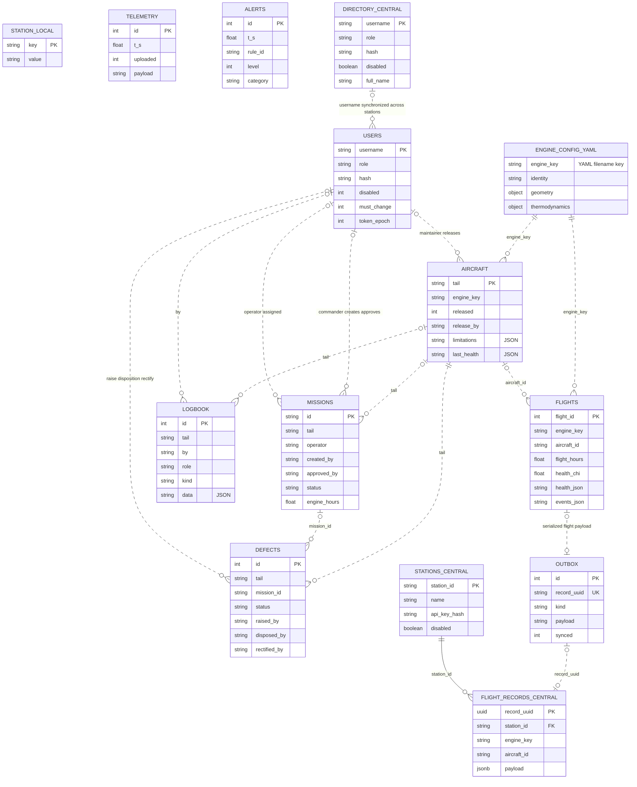
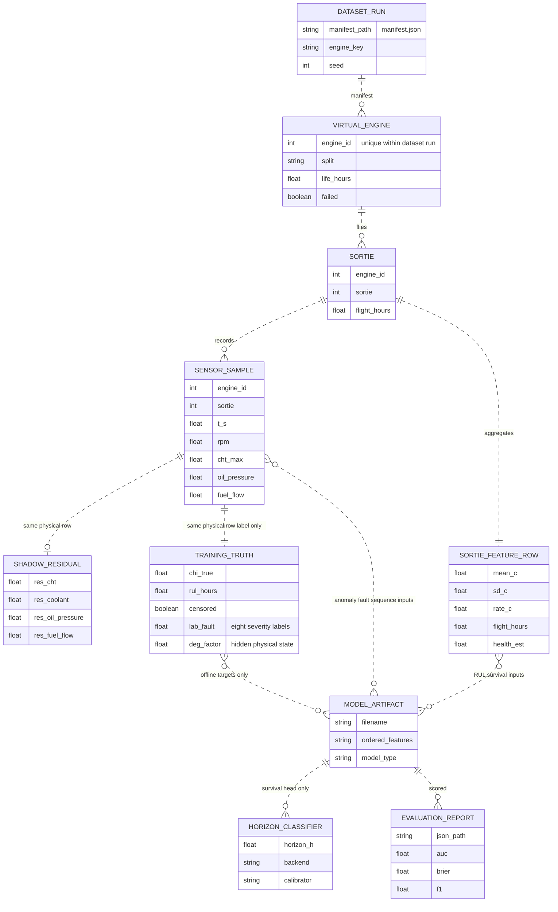
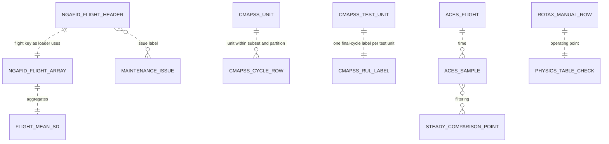

# ASTRA engine, ML, datasets and database reference

Audited checkout: `D:/SIH/Project Phase/DIgital-Twin-for-the-Aero-Piston-Engines`.
Source inspection: 27 October 2026. This describes the current implementation, not a reconstructed chronology of past development. Saved metrics are reported as saved evidence; training and benchmarks were not rerun.

## 1. What we built

ASTRA is a hybrid physics and ML digital twin. The engine itself is a configurable zero-dimensional mean-value engine model (MVEM). ML sits above that model to detect anomalies, name faults, estimate remaining useful life (RUL), and estimate failure probability within a future horizon. CatBoost does not create the engine geometry or solve its thermodynamics.

The principal reference configuration is Rotax 915 iS; an Austro AE330 configuration is also present. An engine configuration describes an engine family; an aircraft tail identifies a fleet asset. Neither a configuration key nor a synthetic engine ID is a unique physical engine serial number.

## 2. Libraries and their actual jobs

| Library | Job in ASTRA | Main evidence |
|---|---|---|
| NumPy | State arrays, numeric transforms, sensor noise, features | layer2_physics/engine_sim.py; layer3_ai/features.py |
| SciPy | Integrates the engine differential equations using solve_ivp / RK45 | layer2_physics/mvem.py |
| Cantera, optional | Combustion equilibrium with GRI-Mech 3.0; precomputed lookup when unavailable | layer2_physics/combustion.py; data/physics/flame_rotax_915is.json |
| pandas + PyArrow | Load, aggregate and write Parquet training data | layer2_physics/synth_data_gen.py; scripts/train_survival.py |
| scikit-learn 1.7.2 | IsolationForest, KMeans/CBLOF, HistGradientBoosting classifiers, probability calibration | layer3_ai/tier2_statistical.py; layer3_ai/rul_survival.py |
| CatBoost >=1.2,<1.3 | Preferred survival/failure-horizon classifier; also used in NGAFID benchmark | layer3_ai/rul_survival.py; scripts/benchmark_ngafid.py |
| PyTorch, optional ml extra | LSTM autoencoder, multitask fault network and RUL LSTM | layer3_ai/tier3_deep.py; layer3_ai/rul_lstm.py |
| ONNX + ONNX Runtime, optional edge extra | Export and run trained neural models at the edge | scripts/export_edge.py; layer1_edge/edge_infer.py |
| PyYAML | Engine, thresholds and fleet definitions | common/config.py |
| SQLite / Python sqlite3 | Local users, operations, flight history, sync outbox, telemetry buffer | layer4_core and layer1_edge |
| PostgreSQL + asyncpg, optional fleet extra | Central stations, flight records and user directory | fleet_server/app.py |

LightGBM appears in the saved booster comparison. It is a comparison candidate, not the preferred survival backend in the current implementation. The dependency declaration is pyproject.toml; installed-package versions were not checked.

## 3. Logical construction steps and files

1. **Define the engine.** Load geometry, thermodynamics, operating limits, turbo and wear parameters from configs/engines/rotax_915is.yaml (or austro_ae330.yaml), through common/config.py.
2. **Build the basic engine physics.** layer2_physics/mvem.py, MeanValueEngineModel, integrates crankshaft speed, manifold pressure, cylinder-head temperatures and oil temperature. Torque, power, exhaust temperature, fuel flow and other outputs are calculated from the state. atmosphere.py, turbo.py, ecu.py, combustion.py, perf_maps.py and om_table.py supply the surrounding models.
3. **Add wear, faults and sensor behavior.** layer2_physics/degradation.py changes physical health factors. engine_sim.py, VirtualEngine, wraps the model with flight phases and simulated sensor readings. Eight injected fault classes are supported.
4. **Create a healthy reference.** layer4_core/shadow_model.py predicts an as-new engine at comparable operating conditions. Residual = measured value minus healthy prediction. This helps distinguish a hot day or high throttle from degradation.
5. **Generate a training fleet.** layer2_physics/synth_data_gen.py runs virtual engines with manufacturing variation, stochastic faults, wear, environments, noise, drift and dropouts. It creates train.parquet, val.parquet, test.parquet and manifest.json. Current constants specify 200 engines and a 60/20/20 initial split (120/40/40). Old introductory comments still mention earlier splits; executable constants take precedence.
6. **Prevent leakage and construct inputs.** layer3_ai/features.py defines common training/serving features, fixed normalization, baseline residuals and forbidden ground-truth columns. Some trainers reconstruct stratified engine assignments from manifest.json, so the on-disk split name alone is not the final assignment used by every trainer.
7. **Train separate estimators.** scripts/eval_tier2.py, train_tier3.py, train_fault_namer.py, train_rul.py and train_survival.py implement their respective tasks. Do not describe these as one CatBoost model.
8. **Validate and deploy.** Thresholds/calibration are learned on non-test data; held-out engines supply evaluation. scripts/export_edge.py exports neural models. Runtime modules load artifacts from data/models/. scripts/retrain_all.py coordinates several training/evaluation stages; it does not include every standalone trainer (notably train_fault_namer.py).

This is the code-supported build sequence, not proof of which file was historically written first.

## 4. Models, outputs and why they exist

| Task | Actual model | Training / evaluation entry | Artifact | Reason |
|---|---|---|---|---|
| Immediate safety limits | Configured deterministic rules | layer1_edge/edge_rules.py | configs/thresholds.yaml | Direct, fast threshold and rate alarms |
| Tier 2 anomaly detection | IsolationForest + KMeans-based CBLOF + matrix-profile method | scripts/eval_tier2.py; layer3_ai/tier2_statistical.py | data/models/tier2_extended.joblib | Detect unusual behavior relative to healthy/conditioned patterns |
| Sequence anomaly detection | LSTM autoencoder | scripts/train_tier3.py | data/models/tier3.pt | Reconstruction error provides a sequence anomaly signal |
| Fault/anomaly/severity | Shared LSTM trunk with three output heads | scripts/train_tier3.py; layer3_ai/tier3_deep.py | data/models/tier3.pt | Learns temporal patterns; multiple simultaneous faults use per-class outputs |
| Fault naming with history | One HistGradientBoosting classifier per fault; sample/history variants | scripts/train_fault_namer.py; layer3_ai/fault_namer.py | data/models/fault_namer.joblib | Tabular current readings and causal sortie history; young-engine fallbacks |
| Remaining useful life | LSTM, compared/fused with physics-based estimates | scripts/train_rul.py; layer3_ai/rul_lstm.py; rul_physics.py; rul_fault.py | data/models/rul_lstm.pt | Compare a learned remaining-hours estimate against degradation-based estimates |
| Failure probability within H hours | CatBoostClassifier, fallback HistGradientBoostingClassifier, isotonic calibration | scripts/train_survival.py; layer3_ai/rul_survival.py | data/models/survival_head.pkl | Calibrated risk is more useful than a falsely precise remaining-hours claim |
| Out-of-distribution gate | Training-distribution check | scripts/fit_ood.py; layer3_ai/ood.py | data/models/ood.npz | Identify inputs outside training support |

RUL LSTM architecture in code: LSTM(64) -> dropout -> LSTM(32) -> dropout -> Dense(16) -> Dense(1). The multitask network has LSTM(64) -> dropout -> LSTM(32) -> Dense(32), then anomaly, fault and severity heads. Checkpoint configuration can govern actual dimensions.

### Why CatBoost was selected

The saved comparison uses identical engine-grouped folds and Brier skill, where higher is better. Values below are mean +/- fold spread from data/benchmarks/booster_comparison.json, also explained in layer3_ai/rul_survival.py.

| Horizon | sklearn HistGB | LightGBM | CatBoost |
|---|---|---|---|
| 25 h | 0.327 +/- 0.047 | 0.354 +/- 0.054 | 0.398 +/- 0.067 |
| 50 h | 0.443 +/- 0.071 | 0.440 +/- 0.078 | 0.454 +/- 0.029 |
| 100 h | 0.479 +/- 0.047 | 0.475 +/- 0.052 | 0.464 +/- 0.059 |

CatBoost performed better on the two shorter horizons and had less fold variation at 50 h. It did not win every horizon. The code uses one backend consistently rather than selecting a winner from small differences at each horizon. sklearn is an availability fallback. At this tabular-data scale, boosting was cheaper to fit/explain than the network and matched its regression performance in the cited experiments.

The target is y_H = 1 when rul_hours <= H, otherwise 0. Each horizon has its own classifier and calibrator. Training code excludes censored engines from this binary fitting/scoring path because the true failure time is unknown. Horizons are 12, 25, 50, 100, 200 and 400 hours; the runtime dispatch presentation selects 12, 25 and 50 hours. AUC measures ranking; Brier measures probability error; Brier skill compares against a constant base-rate predictor. These are different measurements, not interchangeable percentages of accuracy.

## 5. Dataset inventory and exact paths

| Dataset | Files / folders referenced by code | Purpose | Present here? |
|---|---|---|---|
| Synthetic run-to-failure fleet | data/synthetic/train.parquet; val.parquet; test.parquet; manifest.json | Primary anomaly/fault/RUL/survival training and evaluation | Folder absent |
| Hazard-onset variant | data/synthetic_hazard/ | Alternative fleet for RUL/survival experiments; scripts accept --data | Folder absent |
| Manufacturer performance table | configs/engines/rotax_915is_om_performance.csv and .md | Physics input / implementation consistency check | Present |
| Combustion lookup tables | data/physics/flame_rotax_915is.json; flame_rotax_914.json; flame_austro_ae330.json | Precomputed chemistry input, not fault-label training rows | Present |
| NASA C-MAPSS | train_FD001.txt ... train_FD004.txt; test_FD001.txt ... test_FD004.txt; RUL_FD001.txt ... RUL_FD004.txt, under data/benchmarks/ (layer3_ai/cmapss.py::default_root) | Separate turbofan RUL benchmark; not the piston engine training fleet | Raw files not found |
| NGAFID 2days | data/benchmarks/ngafid/2days/flight_header.csv; flight_data.pkl; stats.csv supplies channel ordering reference | Separate real-flight maintenance-classification benchmark | Raw folder absent; ngafid.json report present |
| NASA ACES | data/external/aces/aces1am_2002_DDD.tar -> aces_engine.parquet; aces_twin_flown.parquet | Compare physics with real Altus II Rotax 912 flight logs, not train fault models | Raw folder absent; aces_realdata.json report present |
| Local operational recordings | data/recordings/; data/history/flights.db | Flight replay and trend/history records | Operational storage, not automatically a labeled training dataset |

Important provenance limit: default training paths and report names do not prove exactly which dataset revision trained every shipped binary. The raw manifests are unavailable here. survival_hazard.json describes a historical hazard run and should not be substituted for survival.json. Saved reports and shipped feature sets can belong to different generations. docs/DATA_DOWNLOAD.md explicitly documents missing training/benchmark inputs in this copied repository.

## 6. Synthetic dataset columns

Each physical Parquet file is a wide sample table. The following groups come from synth_data_gen.py::_row and its enrichment steps. The dataset is not a normalized SQL database.

| Group | Column names | Use |
|---|---|---|
| Identity and time | engine_id, split, sortie, t_s, flight_hours | Grouping, partitioning and ordering; flight_hours is explicitly admitted in sortie prognostic features |
| Main sensors | rpm, cht_max, cht_spread, coolant_temperature, egt_max, egt_spread, oil_pressure, oil_temperature, fuel_flow, manifold_pressure, manifold_air_temp, fuel_pressure | Observable engine behavior |
| Vibration | vibration_rms_total, vibration_kurtosis, vib_bpfo, vib_bpfi, vib_bsf, vib_ftf | Vibration magnitude and bearing-order signatures |
| Electrical | battery_voltage, alternator_current | Electrical measurements |
| Injection / ignition | injection_deviation_max, ignition_deviation_max, injection_period_ms, injector_duty, knock_retard_deg | Control and combustion behavior |
| Actuators / lane agreement | wastegate_pct, cooling_flap_pct, rpm_lane_delta, map_lane_delta | Remaining control authority and redundant lane differences |
| Operating conditions | throttle_pct, altitude_ft, oat_c, airspeed_kmh, air_flow_g_per_min | Conditions driving the engine |
| Derived | cht_minus_coolant | Head/coolant relationship |
| Healthy-model residuals | res_cht, res_coolant, res_egt, res_oil_pressure, res_oil_temperature, res_fuel_flow, res_manifold_pressure, res_wastegate, res_cooling_flap, shadow_available | Compare with the healthy twin |
| Health truth | thi_true, mhi_true, comb_hi_true, chi_true | Supervision / evaluation labels, not model inputs |
| Physical truth | deg_* for DegradationFactors fields | Simulator-only hidden state; never admitted as observable features |
| Fault truth | lab_misfire, lab_injector_abnormal, lab_cooling_degradation, lab_lubrication_issue, lab_sensor_drift, lab_combustion_instability, lab_overheating_trend, lab_abnormal_vibration, any_fault | Fault/severity supervision |
| Life labels | rul_hours, censored | Failure-time target / observation truncation flag |

Temperature sensors are in degrees C, rpm in revolutions/minute, oil_pressure in psi (converted from bar), fuel_flow in L/h, flight_hours in hours, altitude_ft in feet. Consult SensorFrame and generator conversions for the remaining units.

Feature processing adds structured residual signatures res_isolation, res_n_excursions, res_top_abs and scatter features. The current shared extended feature set uses the seven PRD channels, six core residuals, and the derived features declared in features.py. Not every dataset column enters every model. The exact ordered checkpoint feature list is authoritative for its serving model.

For sortie training, sortie_features.py builds mean c, within-sortie sd_c, and causal between-sortie rate_c for each selected feature c, plus flight_hours and optional health_est/rate_health_est. health_est is sensor-estimated health; chi_true is hidden simulator truth. They must not be confused. The current default uses one sortie row per model input.

### External dataset columns

C-MAPSS: unit, cycle, op_setting_1..3, sensor_1..21 (26 raw columns). Test RUL files have one remaining-cycle label per test unit. Cycle-based turbofan results are not flight-hour accuracy on Rotax engines.

NGAFID flight arrays: volt1, volt2, amp1, amp2, FQtyL, FQtyR, E1 FFlow, E1 OilT, E1 OilP, E1 RPM, E1 CHT1..4, E1 EGT1..4, OAT, IAS, VSpd, NormAc, AltMSL. The benchmark converts each flight into channel means and standard deviations (46 inputs). Maintenance issue/label and fold metadata come from flight_header.csv; flight_data.pkl holds arrays. See benchmark_ngafid.py for the exact header join/filter behavior.

ACES extracted channel names include rpm, map_bar, altitude_ft, density_alt_ft, static_inhg, kias, ktas, throttle_cmd_pct, throttle_angle_pct, cht_c, coolant_c, oil_temperature_c, oil_pressure_psi, egt1_c..egt4_c, fuel_burned_lb, fuel_pressure_psi, cowl_flap_pct, battery_v, turbo_rpm, compressor_out_inhg, gps_time_s. Extraction derives EGT summaries and fuel flow. Fuel burned is cumulative and cannot be treated directly as fuel-flow rate. Exact conversion map: scripts/aces_extract.py::CHANNELS.

Manufacturer CSV columns: pdf_page, number, rpm, p_amb_bar, t_amb_c, throttle_pct, alt_ft, power_kw, fuel_kg_h, p_plenum_bar, t_plenum_k.

## 7. Saved results and what they establish

These are historical report values read from this checkout, not fresh tests or demonstrated real-aircraft performance.

### data/models/tier2_report.json

```json
{
  "roc_auc": 0.9144072669881753,
  "deployed_decision_rule": {
    "rule": "per-condition limits + 2-of-3",
    "conditions": 17,
    "precision": 0.9747136508731301,
    "recall": 0.6119056974459725,
    "f1": 0.7518285176334274,
    "fpr": 0.04797340088663711,
    "false_alarms_per_engine_hour": 0.19962202298109213,
    "lead_time": {
      "engines": 31,
      "detected": 31,
      "median_lead_h": 314.8308856196735,
      "mean_lead_h": 393.5660820437693,
      "min_lead_h": 62.664477731684855,
      "max_lead_h": 1077.3979934446686
    }
  }
}
```

### data/models/tier3_report.json

```json
{
  "autoencoder": {
    "auc": 0.9180413286908259,
    "precision": 0.945980985306828,
    "recall": 0.2867059593975115,
    "f1": 0.44004422555030664,
    "fpr": 0.04950495049504951,
    "tp": 2189,
    "fp": 125,
    "fn": 5446,
    "tn": 2400
  },
  "anomaly_head": {
    "auc": 0.954121755594027,
    "precision": 0.9702185792349727,
    "recall": 0.9301899148657499,
    "f1": 0.9497826813774657,
    "fpr": 0.08633663366336633,
    "tp": 7102,
    "fp": 218,
    "fn": 533,
    "tn": 2307
  },
  "fault": {
    "macro_precision": 0.6298302430901985,
    "macro_recall": 0.6257359225665738,
    "macro_f1": 0.6099091457386978,
    "macro_f1_all_eight": 0.6099091457386978,
    "excluded": [],
    "exact_match": 0.46091245376078915
  }
}
```

### data/models/fusion_report.json

```json
{
  "chosen_combiner": "head",
  "test": {
    "auc": 0.9890452385120634,
    "val_f1": 0.8655881765528262,
    "precision": 0.9963990997749438,
    "recall": 0.8698100851342502,
    "f1": 0.9288111888111888,
    "fpr": 0.009504950495049505
  }
}
```

### Survival saved report structure

Top-level keys: features, seeds, results. The table below preserves run labels and horizons; it does not mix runs.

| Report location | Horizon h | AUC | Brier | Brier skill | Skilful |
|---|---:|---:|---:|---:|---|
| root/results/0 val-set calibration/test/horizons/0  | 12.0 | 0.9087 | 0.0188 | 0.3185 | True |
| root/results/0 val-set calibration/test/horizons/1  | 25.0 | 0.9415 | 0.029 | 0.4702 | True |
| root/results/0 val-set calibration/test/horizons/2  | 50.0 | 0.9277 | 0.0539 | 0.4312 | True |
| root/results/0 val-set calibration/test/horizons/3  | 100.0 | 0.8914 | 0.0844 | 0.4713 | True |
| root/results/0 val-set calibration/test/horizons/4  | 200.0 | 0.8379 | 0.1492 | 0.3694 | True |
| root/results/0 val-set calibration/test/horizons/5  | 400.0 | 0.7677 | 0.1693 | 0.1966 | True |
| root/results/1 out-of-fold calibration/test/horizons/0  | 12.0 | 0.9233 | 0.0192 | 0.3054 | True |
| root/results/1 out-of-fold calibration/test/horizons/1  | 25.0 | 0.945 | 0.029 | 0.4704 | True |
| root/results/1 out-of-fold calibration/test/horizons/2  | 50.0 | 0.9252 | 0.05 | 0.4724 | True |
| root/results/1 out-of-fold calibration/test/horizons/3  | 100.0 | 0.8988 | 0.0762 | 0.5225 | True |
| root/results/1 out-of-fold calibration/test/horizons/4  | 200.0 | 0.8467 | 0.1368 | 0.4221 | True |
| root/results/1 out-of-fold calibration/test/horizons/5  | 400.0 | 0.7698 | 0.169 | 0.1983 | True |

Physics table report: data/models/physics_om_validation.json uses 130 manufacturer-table points. Median absolute power error is 1.05%, but the 95th percentile is 44.494% and maximum 92.766%. Reporting only the median would hide large operating-point errors. The table is already a model input, so this is implementation consistency, not independent validation.

Real-data check: data/benchmarks/aces_realdata.json reports 54 flights and 202 steady points. For example, coolant trend correlation is 0.796, while oil-pressure correlation is -0.36 and oil-temperature offset is +31.23 C. This is mixed evidence with substantial mismatch, not proof the 915 model faithfully reproduces a real 912 installation.

NGAFID saved CatBoost ROC-AUC is 0.7716 +/- 0.0231 for intake gasket leak/damage and 0.7636 +/- 0.0091 for rocker-cover leak/loose/damage. These are separate benchmark classifiers; they do not establish performance for all eight simulated ASTRA faults.

## 8. Database design and roles

Commander, Operator, Maintainer and Engineer are values of users.role / directory.role, not four different tables. Local users live in data/keys/users.db; central directory users live in PostgreSQL. Username strings identify actors in mission, aircraft release, defect and logbook records. The local SQL does not declare these strings as foreign keys.

Engine definitions live in configs/engines/*.yaml. Aircraft reference those definitions through engine_key. Saved physical twin state is file-based under data/twin_state/. There is no SQL engines table in the schemas inspected. The diagram's ENGINE_CONFIG is explicitly a YAML entity.

Storage boundaries:
- data/ops/squadron.db: aircraft, missions, defects, logbook, station.
- data/keys/users.db: users.
- data/history/flights.db: flights.
- data/history/outbox.db: outbox.
- EdgeBuffer's configured SQLite path: telemetry, alerts.
- Central PostgreSQL via DT_FLEET_DSN: stations, flight_records, directory.
- data/audit/audit.jsonl: audit records, a file rather than an SQL table.

The following diagram covers all 13 SQL tables plus the YAML engine configuration. Solid relationship: declared SQL FK. Dashed relationships: logical/application linkage, often across separate stores. Relationships express intended multiplicity; the database does not enforce dashed links. Optional identifiers can be absent. The outbox relationship depicts flight synchronization messages only; other message kinds need not reference flight records.



STATION_LOCAL is a key/value operations store, distinct from central station registration. TELEMETRY and ALERTS have no declared FK linking them to each other or to aircraft; payload/context supplies identity where available. Audit JSONL is not linked by an invented SQL relationship.

### Complete SQL table definitions

The ER view above abbreviates columns. The definitions below are extracted verbatim from source and include every declared column. Runtime migration logic may add columns; inspect the cited source for migrations. No private user rows or credentials were read.

### layer4_core/ops.py

```sql
CREATE TABLE IF NOT EXISTS aircraft (
    tail TEXT PRIMARY KEY,
    engine_key TEXT,
    released INTEGER NOT NULL DEFAULT 0,
    release_by TEXT, release_utc TEXT, release_note TEXT,
    limitations TEXT NOT NULL DEFAULT '{}',
    last_health TEXT NOT NULL DEFAULT '{}',
    pending_maintenance TEXT NOT NULL DEFAULT '[]',
    sorties INTEGER NOT NULL DEFAULT 0,
    ground_runs INTEGER NOT NULL DEFAULT 0
);
```

```sql
CREATE TABLE IF NOT EXISTS missions (
    id TEXT PRIMARY KEY,
    name TEXT NOT NULL, type TEXT NOT NULL, status TEXT NOT NULL,
    environment TEXT NOT NULL, duration_h REAL NOT NULL,
    altitude_ft REAL NOT NULL, throttle_pct REAL NOT NULL,
    area TEXT, launch_utc TEXT, priority TEXT, notes TEXT,
    created_by TEXT, created_utc TEXT,
    approved_by TEXT, approved_utc TEXT,
    tail TEXT, operator TEXT, assessment TEXT,
    preflight TEXT, prepared_utc TEXT, started_utc TEXT, launched_utc TEXT,
    landed_utc TEXT, completed_utc TEXT,
    outcome TEXT, debrief TEXT, engine_hours REAL,
    cancelled_by TEXT, cancel_reason TEXT
);
```

```sql
CREATE TABLE IF NOT EXISTS defects (
    id INTEGER PRIMARY KEY AUTOINCREMENT,
    tail TEXT NOT NULL, mission_id TEXT,
    source TEXT NOT NULL, raised_by TEXT, raised_role TEXT, raised_utc TEXT,
    description TEXT NOT NULL, severity TEXT NOT NULL,
    grounding INTEGER NOT NULL DEFAULT 0,
    status TEXT NOT NULL, action_id TEXT, evidence TEXT,
    disposition TEXT, disposition_note TEXT, disposed_by TEXT, disposed_utc TEXT,
    defer_until_hours REAL,
    rectified_by TEXT, rectified_utc TEXT, rectification TEXT
);
```

```sql
CREATE TABLE IF NOT EXISTS logbook (
    id INTEGER PRIMARY KEY AUTOINCREMENT,
    tail TEXT, utc TEXT NOT NULL, kind TEXT NOT NULL,
    by TEXT, role TEXT, text TEXT NOT NULL, data TEXT
);
```

```sql
CREATE TABLE IF NOT EXISTS station (
    key TEXT PRIMARY KEY, value TEXT
);
```

### layer4_core/security.py

```sql
CREATE TABLE IF NOT EXISTS users (
    username     TEXT    PRIMARY KEY,
    role         TEXT    NOT NULL,
    hash         TEXT    NOT NULL,
    disabled     INTEGER NOT NULL DEFAULT 0,
    must_change  INTEGER NOT NULL DEFAULT 1,
    token_epoch  INTEGER NOT NULL DEFAULT 0,
    created_utc  TEXT    NOT NULL,
    updated_utc  TEXT    NOT NULL
);
```

### layer4_core/history.py

```sql
CREATE TABLE IF NOT EXISTS flights (
    flight_id     INTEGER PRIMARY KEY AUTOINCREMENT,
    recorded_utc  TEXT    NOT NULL,
    engine_key    TEXT    NOT NULL,
    aircraft_id   TEXT,
    flight_hours  REAL,
    altitude_ft   REAL, oat_c REAL, airspeed_kmh REAL,
    throttle_pct  REAL, rpm REAL, manifold_pressure_bar REAL,
    cht_max_c REAL, cht_spread_c REAL, egt_max_c REAL, egt_spread_c REAL,
    oil_pressure_psi REAL, oil_temperature_c REAL, coolant_temperature_c REAL,
    fuel_flow_lph REAL, power_kw REAL,
    health_chi    REAL,
    -- The SUBSYSTEM indices, not just the overall figure. The post-flight
    -- report shows "change since previous flight" per subsystem, and one
    -- number cannot answer that: an engine whose cooling fell while its
    -- lubrication improved has a flat chi and two findings.
    health_json   TEXT,
    events_json   TEXT,
    schema_version INTEGER NOT NULL
);
```

### layer4_core/fleet_sync.py

```sql
CREATE TABLE IF NOT EXISTS outbox (
    id           INTEGER PRIMARY KEY AUTOINCREMENT,
    record_uuid  TEXT    NOT NULL UNIQUE,
    kind         TEXT    NOT NULL,
    payload      TEXT    NOT NULL,
    created_utc  TEXT    NOT NULL,
    attempts     INTEGER NOT NULL DEFAULT 0,
    last_error   TEXT,
    synced       INTEGER NOT NULL DEFAULT 0,
    synced_utc   TEXT
);
```

### layer1_edge/edge_buffer.py

```sql
CREATE TABLE IF NOT EXISTS telemetry (
                id       INTEGER PRIMARY KEY AUTOINCREMENT,
                t_s      REAL    NOT NULL,
                uploaded INTEGER NOT NULL DEFAULT 0,
                payload  TEXT    NOT NULL
            );
```

```sql
CREATE TABLE IF NOT EXISTS alerts (
                id        INTEGER PRIMARY KEY AUTOINCREMENT,
                t_s       REAL    NOT NULL,
                rule_id   TEXT    NOT NULL,
                legend    TEXT    NOT NULL,
                level     INTEGER NOT NULL,
                category  TEXT    NOT NULL,
                value     REAL,
                uploaded  INTEGER NOT NULL DEFAULT 0
            );
```

### fleet_server/app.py

```sql
CREATE TABLE IF NOT EXISTS stations (
    station_id     TEXT PRIMARY KEY,
    name           TEXT,
    api_key_hash   TEXT NOT NULL,
    disabled       BOOLEAN NOT NULL DEFAULT FALSE,
    first_seen_utc TIMESTAMPTZ NOT NULL DEFAULT now(),
    last_seen_utc  TIMESTAMPTZ
);
```

```sql
CREATE TABLE IF NOT EXISTS flight_records (
    record_uuid    UUID PRIMARY KEY,
    station_id     TEXT NOT NULL REFERENCES stations(station_id),
    engine_key     TEXT,
    aircraft_id    TEXT,
    recorded_utc   TIMESTAMPTZ,
    flight_hours   DOUBLE PRECISION,
    altitude_ft    DOUBLE PRECISION,
    oat_c          DOUBLE PRECISION,
    airspeed_kmh   DOUBLE PRECISION,
    throttle_pct   DOUBLE PRECISION,
    cht_max_c      DOUBLE PRECISION,
    cht_spread_c   DOUBLE PRECISION,
    egt_max_c      DOUBLE PRECISION,
    egt_spread_c   DOUBLE PRECISION,
    oil_pressure_psi      DOUBLE PRECISION,
    oil_temperature_c     DOUBLE PRECISION,
    coolant_temperature_c DOUBLE PRECISION,
    fuel_flow_lph  DOUBLE PRECISION,
    power_kw       DOUBLE PRECISION,
    health_chi     DOUBLE PRECISION,
    payload        JSONB,
    received_utc   TIMESTAMPTZ NOT NULL DEFAULT now()
);
```

```sql
CREATE TABLE IF NOT EXISTS directory (
    username     TEXT    PRIMARY KEY,
    role         TEXT    NOT NULL,
    hash         TEXT    NOT NULL,
    disabled     BOOLEAN NOT NULL DEFAULT FALSE,
    must_change  BOOLEAN NOT NULL DEFAULT TRUE,
    token_epoch  BIGINT  NOT NULL DEFAULT 0,
    full_name    TEXT,
    created_utc  TIMESTAMPTZ NOT NULL DEFAULT now(),
    updated_utc  TIMESTAMPTZ NOT NULL DEFAULT now()
);
```

## 9. Separate ML dataset ER diagram

This is a conceptual decomposition of flat Parquet records and model artifacts, not a claim that these SQL tables exist. Sample identity is represented by engine + sortie + time; uniqueness should be checked before converting it into a database key. Labels and features occupy the same physical row but must be separated logically to prevent leakage.



### Separate external benchmark dataset relationships

These are conceptual file relationships; they are not joined into the synthetic training fleet.



## 10. Practical explanation for a presentation or viva

“We first created a configurable physics model of the UAV piston engine using NumPy and SciPy, with optional Cantera combustion calculations. We added degradation, injected faults and realistic sensor effects to generate labeled run-to-failure engine data. We compared readings with a healthy shadow engine and used those residuals as ML inputs. scikit-learn detects statistical anomalies and names faults, PyTorch LSTMs learn sequence patterns and estimate remaining life, and CatBoost estimates calibrated failure probability within a future horizon. We chose CatBoost based on engine-grouped Brier-skill comparisons, particularly at 25 and 50 hours. The main ML evidence is simulated; separate real-flight benchmarks and physics checks provide limited external evidence.”

Do not say: “CatBoost created the 3D engine,” “all models were trained on NASA data,” “the system has 99% accuracy,” or “the database has separate Commander and Operator tables.” None of those descriptions matches the inspected implementation.

## 11. Source index

- [pyproject.toml](D:/SIH/Project Phase/DIgital-Twin-for-the-Aero-Piston-Engines/pyproject.toml)

- [common/config.py](D:/SIH/Project Phase/DIgital-Twin-for-the-Aero-Piston-Engines/common/config.py)

- [configs/engines/rotax_915is.yaml](D:/SIH/Project Phase/DIgital-Twin-for-the-Aero-Piston-Engines/configs/engines/rotax_915is.yaml)

- [configs/engines/austro_ae330.yaml](D:/SIH/Project Phase/DIgital-Twin-for-the-Aero-Piston-Engines/configs/engines/austro_ae330.yaml)

- [configs/engines/rotax_915is_om_performance.csv](D:/SIH/Project Phase/DIgital-Twin-for-the-Aero-Piston-Engines/configs/engines/rotax_915is_om_performance.csv)

- [configs/fleet.yaml](D:/SIH/Project Phase/DIgital-Twin-for-the-Aero-Piston-Engines/configs/fleet.yaml)

- [layer2_physics/mvem.py](D:/SIH/Project Phase/DIgital-Twin-for-the-Aero-Piston-Engines/layer2_physics/mvem.py)

- [layer2_physics/combustion.py](D:/SIH/Project Phase/DIgital-Twin-for-the-Aero-Piston-Engines/layer2_physics/combustion.py)

- [layer2_physics/engine_sim.py](D:/SIH/Project Phase/DIgital-Twin-for-the-Aero-Piston-Engines/layer2_physics/engine_sim.py)

- [layer2_physics/degradation.py](D:/SIH/Project Phase/DIgital-Twin-for-the-Aero-Piston-Engines/layer2_physics/degradation.py)

- [layer2_physics/synth_data_gen.py](D:/SIH/Project Phase/DIgital-Twin-for-the-Aero-Piston-Engines/layer2_physics/synth_data_gen.py)

- [layer4_core/shadow_model.py](D:/SIH/Project Phase/DIgital-Twin-for-the-Aero-Piston-Engines/layer4_core/shadow_model.py)

- [layer3_ai/features.py](D:/SIH/Project Phase/DIgital-Twin-for-the-Aero-Piston-Engines/layer3_ai/features.py)

- [layer3_ai/sortie_features.py](D:/SIH/Project Phase/DIgital-Twin-for-the-Aero-Piston-Engines/layer3_ai/sortie_features.py)

- [layer3_ai/tier2_statistical.py](D:/SIH/Project Phase/DIgital-Twin-for-the-Aero-Piston-Engines/layer3_ai/tier2_statistical.py)

- [layer3_ai/tier3_deep.py](D:/SIH/Project Phase/DIgital-Twin-for-the-Aero-Piston-Engines/layer3_ai/tier3_deep.py)

- [layer3_ai/rul_lstm.py](D:/SIH/Project Phase/DIgital-Twin-for-the-Aero-Piston-Engines/layer3_ai/rul_lstm.py)

- [layer3_ai/rul_survival.py](D:/SIH/Project Phase/DIgital-Twin-for-the-Aero-Piston-Engines/layer3_ai/rul_survival.py)

- [layer3_ai/survival_serving.py](D:/SIH/Project Phase/DIgital-Twin-for-the-Aero-Piston-Engines/layer3_ai/survival_serving.py)

- [scripts/train_fault_namer.py](D:/SIH/Project Phase/DIgital-Twin-for-the-Aero-Piston-Engines/scripts/train_fault_namer.py)

- [scripts/train_survival.py](D:/SIH/Project Phase/DIgital-Twin-for-the-Aero-Piston-Engines/scripts/train_survival.py)

- [scripts/train_rul.py](D:/SIH/Project Phase/DIgital-Twin-for-the-Aero-Piston-Engines/scripts/train_rul.py)

- [scripts/retrain_all.py](D:/SIH/Project Phase/DIgital-Twin-for-the-Aero-Piston-Engines/scripts/retrain_all.py)

- [docs/DATA_DOWNLOAD.md](D:/SIH/Project Phase/DIgital-Twin-for-the-Aero-Piston-Engines/docs/DATA_DOWNLOAD.md)

- [layer3_ai/cmapss.py](D:/SIH/Project Phase/DIgital-Twin-for-the-Aero-Piston-Engines/layer3_ai/cmapss.py)

- [scripts/benchmark_ngafid.py](D:/SIH/Project Phase/DIgital-Twin-for-the-Aero-Piston-Engines/scripts/benchmark_ngafid.py)

- [scripts/aces_extract.py](D:/SIH/Project Phase/DIgital-Twin-for-the-Aero-Piston-Engines/scripts/aces_extract.py)

- [scripts/eval_aces_realdata.py](D:/SIH/Project Phase/DIgital-Twin-for-the-Aero-Piston-Engines/scripts/eval_aces_realdata.py)

- [layer4_core/security.py](D:/SIH/Project Phase/DIgital-Twin-for-the-Aero-Piston-Engines/layer4_core/security.py)

- [layer4_core/ops.py](D:/SIH/Project Phase/DIgital-Twin-for-the-Aero-Piston-Engines/layer4_core/ops.py)

- [layer4_core/history.py](D:/SIH/Project Phase/DIgital-Twin-for-the-Aero-Piston-Engines/layer4_core/history.py)

- [layer4_core/fleet_sync.py](D:/SIH/Project Phase/DIgital-Twin-for-the-Aero-Piston-Engines/layer4_core/fleet_sync.py)

- [layer1_edge/edge_buffer.py](D:/SIH/Project Phase/DIgital-Twin-for-the-Aero-Piston-Engines/layer1_edge/edge_buffer.py)

- [fleet_server/app.py](D:/SIH/Project Phase/DIgital-Twin-for-the-Aero-Piston-Engines/fleet_server/app.py)
