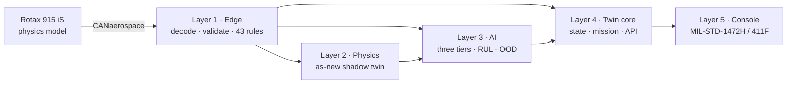

<div align="center">

# ASTRA

### AI-Enabled Real-Time Digital Twin for Aero Piston Engines

**Defence Research and Development Organisation · Smart India Hackathon 2026**
**Problem Statement 26054**

Health monitoring, fault prediction and mission-reliability enhancement for the
propulsion of Medium Altitude Long Endurance Unmanned Aerial Vehicles

`Restricted (Government Use Only)`

`physics-informed` · `edge-first` · `evidence-led`

</div>

---

## Contents

**Understanding the system**
[Overview](#overview) ·
[The problem](#the-problem) ·
[What ASTRA does](#what-astra-does) ·
[How it works](#how-it-works) ·
[Glossary](#glossary)

**Evidence**
[The result, in one table](#the-result-in-one-table) ·
[The number that decides this](#the-number-that-decides-this) ·
[How it sees what limits cannot](#how-it-sees-what-limits-cannot) ·
[Measured results](#measured-results) ·
[Why these numbers hold up](#why-these-numbers-hold-up) ·
[Known limits](#known-limits)

**Using it**
[Architecture](#architecture) ·
[Install and run](#install-and-run) ·
[Repository layout](#repository-layout) ·
[Documentation](#documentation) ·
[Provenance](#provenance)

---

## Overview

ASTRA is a **digital twin** of an aircraft engine: a complete software model of
a specific engine that runs continuously alongside the real one, receives its
live telemetry, and reports the engine's true internal condition in real time.

The engine modelled here is the **Rotax 915 iS / iSc A**, a 104 kW turbocharged
four-cylinder aero piston engine used on Medium Altitude Long Endurance
unmanned aircraft. The twin is driven by the same throttle setting, engine
speed, altitude and outside air temperature as the real engine, and it computes
what a *brand-new* engine would be doing under exactly those conditions.

The difference between the two — what the engine is doing versus what a healthy
engine would be doing — is the measurement everything else is built on. It
reveals wear, blockage, fouling and drift long before any instrument reading
leaves its permitted range.

The system answers four questions continuously, for an aircraft with no pilot
aboard to notice anything unusual:

1. **What condition is this engine in right now?**
2. **Is anything going wrong, and in which subsystem?**
3. **How long before it needs maintenance?**
4. **Will it complete the mission it has been assigned?**

---

## The problem

A Medium Altitude Long Endurance UAV flies for **twenty to thirty hours at a
time**, often far from its operator, with a **single engine** and nobody on
board. If that engine fails, the aircraft is lost — along with its sensors, its
mission and whatever it was carrying.

Conventional engine monitoring compares each reading against a certified limit
and raises an alarm when a limit is crossed. This is correct, it is required by
certification, and **it is fundamentally blind to degradation.**

A limit answers one question: *is this reading unacceptable right now?*
It cannot answer the question that actually matters: *is this engine getting
worse?*

Consider a cooling passage slowly silting up over hundreds of flight hours.
Coolant temperature rises from 98 °C to 100 °C. The limit is 120 °C. Every
check passes, every flight is logged as normal, and the fault is invisible —
until the day the reserve is gone and the temperature runs away in minutes.

> In this system's own test data, across 12,165 evaluated windows, the certified
> limits raise an alarm on **77** of them. In the same data there are **7,558**
> windows in which the engine is genuinely degrading and **not one limit is
> exceeded.** A conventional monitor has nothing to say about any of them.

That gap — between "within limits" and "healthy" — is what ASTRA exists to
close.

---

## What ASTRA does

The problem statement asks for five capabilities. This repository implements
all five, end to end, from the engine's data bus to the operator's console.

### 1 · Real-time state estimation

The twin reconstructs quantities the engine does not directly measure —
combustion behaviour, turbocharger and intercooler state, heat flow into the
cylinder head and the coolant — from the telemetry it does provide, and
publishes a complete picture of engine condition every tick.

### 2 · Anomaly detection

Three independent detection layers examine each window of flight data:
certified-limit rules at the edge, a statistical ensemble, and a deep neural
network. Their verdicts are **fused**, so a warning must convince more than one
method before it reaches the operator. This is why the system can be sensitive
to degradation without flooding the crew with false alarms.

### 3 · Degradation tracking

Six physical wear pathways are modelled explicitly — cooling-system fouling,
injector fouling, turbocharger wear, bearing wear, lubrication degradation and
sensor drift. Each is tracked against the engine's own as-new baseline, so wear
is attributed to a **named subsystem**, not reported as a single unexplained
score.

### 4 · Fault prediction and remaining useful life

The system estimates how much service life remains before maintenance is
required, and — critically — publishes a **confidence interval** with it. Where
that interval cannot be calibrated from the available evidence, the system
withholds the figure and states why, rather than printing a number that looks
authoritative and is not.

### 5 · Mission reliability and replay

Before a sortie, the twin estimates the probability that the engine will
complete the assigned mission profile. After a sortie, the full flight can be
replayed against the recorded telemetry for post-flight analysis and
maintenance planning.

---

## How it works

<div align="center">

**Real engine → CAN bus → edge validation → shadow twin → AI analysis → console**

</div>

**The engine speaks.** The Rotax 915 iS carries a FADEC — a Full Authority
Digital Engine Control — with **two independent control lanes** for redundancy.
It broadcasts engine data over a **CANaerospace** bus, the aerospace data
standard used in this class of aircraft.

**The edge computer listens, and does not trust.** Every frame is checked for
who sent it and what type of data it claims to carry. Sensors are checked for
being frozen, stuck, drifting, or disagreeing between the two FADEC lanes. Each
value carries a state — valid, suspect, stale, failed — that travels with it
through the entire system. Forty-three certified-limit rules run here, on the
aircraft, so safety alerts never depend on a working data link.

**The shadow twin predicts.** In parallel, a full physics model of the same
engine — permanently held at zero hours, never degrading — computes what a
brand-new engine would do at this exact operating point.

**The difference is the signal.** The gap between measured and as-new is the
**residual**. Residuals move from the first flight hour, long before any
absolute reading approaches a limit. The three detection tiers, the health
indices and the life estimators all work on residuals rather than raw readings.

**Control authority is watched too.** When something degrades, the engine's
automatic controls compensate — the turbocharger wastegate and the cooling-air
flaps move further to hold the same temperature and pressure. The readings stay
normal; the **reserve** silently disappears. ASTRA measures how much authority
has been spent, which is a far earlier warning than any temperature.

**The operator sees a decision, not data.** The console presents condition,
cause, deadline and confidence, on a defence human-machine interface standard
(MIL-STD-1472H / MIL-STD-411F).

**And it runs on the aircraft.** The served model is 150 KB, infers in 0.64 ms,
and occupies 69 MB of memory — 3.4 % of the smallest Raspberry Pi. A 72-hour
buffer keeps the system working with no link to the ground at all.

---

## Glossary

| Term | What it means |
|---|---|
| **MALE UAV** | Medium Altitude Long Endurance Unmanned Aerial Vehicle — flies 20–30 hours at a stretch, with no crew on board |
| **Digital twin** | A software model of a specific physical machine, running live alongside it and fed by its real data |
| **FADEC** | Full Authority Digital Engine Control — the engine's computer. It has two independent lanes so that one failure cannot stop the engine |
| **CANaerospace** | The aerospace standard for carrying engine and avionics data on a CAN bus |
| **Residual** | Measured value minus what a brand-new engine would read under identical conditions. The core measurement in this system |
| **Control authority** | How much travel a control still has in reserve. A cooling flap at 49 % has room left; the same flap at 100 % has none |
| **RUL** | Remaining Useful Life — the flight hours left before maintenance is required |
| **CHT / EGT** | Cylinder Head Temperature / Exhaust Gas Temperature |
| **False-positive rate** | How often the system cries wolf on a healthy engine. The number that decides whether anyone keeps reading the alerts |
| **Held-out engines** | Engines the models were never trained on. Every result in this document is reported only on these |

---

## The result, in one table

Measured on **40 engines the models have never seen**, from a 200-engine
run-to-failure fleet. Every figure below is written by a script in this
repository into a JSON artefact you can open.

| | Measured | Artefact |
|---|---|---|
| **Alarm precision** | **0.996** | `data/models/fusion_report.json` |
| **Detection ROC-AUC** | **0.989** | `data/models/fusion_report.json` |
| **False-positive rate** | **1.0 %** of windows on healthy engines | `data/models/fusion_report.json` |
| **False alarms per engine-hour** | **0.20** (statistical tier, per-condition limits; was 0.29) | `data/models/tier2_report.json` |
| Fault classification, 8 classes | macro-F1 **0.780** (was 0.610) · misfire 0.97 · lubrication 0.92 | `data/models/fault_namer_report.json` |
| Health index vs ground truth | MAE **0.077**, 0.6 % of healthy engines mislabelled | `data/training_logs/eval_health.log` |
| Twin tick latency | p50 **51 ms** · p95 **83 ms** (budget 200 ms) | `data/models/latency_bench.json` |
| Edge model | **150 KB** ONNX · **0.64 ms** inference · 69 MB RAM | `data/models/edge_footprint.json` |
| Problem-statement traceability | **82 / 86 BUILT**, 0 MISSING | `python scripts/ps_compliance.py` |

---

## The number that decides this

Return to the **7,558 windows** described in [The problem](#the-problem): the
engine is genuinely degrading, and every certified limit is still satisfied. A
conventional monitor is silent for all of them. It is not badly tuned — it has
nothing to say.

<div align="center">

### ASTRA raises **6,567** of them.

</div>

That is 6,567 warnings of real degradation that no threshold monitor in
existence could have produced — delivered at **99.6 % precision**, so the
operator is not paying for them in noise.

```
  certified limits fire on              77 windows
  the problem statement's own logic     74 windows
  ASTRA                              7,256 windows   <- 6,567 of them otherwise missed
```

*(reproduce: `python scripts/eval_fusion.py`, output in `data/training_logs/eval_fusion.log`)*

---

## How it sees what limits cannot

### 1 · A second engine, permanently as-new

A shadow model of the same engine runs beside the real one, driven by the same
throttle, speed, altitude and outside air temperature, and held forever at
zero hours. The gap between the two is the **residual**, and it moves from the
first flight hour.

| Condition | Health | Thermal | Limits exceeded | What the operator sees |
|---|---|---|---|---|
| Healthy | 0.975 `EXCELLENT` | 1.00 | 0 | nothing — the console stays silent |
| Cooling degradation | 0.872 `GOOD` | **0.62** | **0** | **CAUTION** — thermal subsystem POOR, maintain within 25 h |

A cylinder head running 8 K hotter than an as-new engine would at the same
operating point: named to a subsystem, given a maintenance deadline, **with
zero certified limits exceeded.**

### 2 · Control authority, not just temperature

This engine has **no thermostat** — confirmed against all thirteen
manufacturer manuals. Its temperatures are held by the airframe's cooling-air
flaps, and like the turbocharger's wastegate, a flap **runs out of travel**.

Degradation spends control authority long before it moves a temperature.

| Radiator blockage | Coolant temperature | Cooling flap | Caught by |
|---|---|---|---|
| none | 98.4 °C | 0.49 | — |
| 30 % | 100.3 °C | 0.68 | **authority check** |
| 45 % | 101.9 °C | 0.84 | **authority check** |
| 70 % | 143.7 °C | 1.00 **saturated** | temperature limit (too late) |

A 30 % blockage moves coolant temperature **1.9 °C** — no limit will ever catch
it. It moves the flap **0.19 of its full travel** — measurable on the first
sortie.

---

## Measured results

### Detection

Held-out engines, thresholds fixed on training and validation data and never
moved to suit the test set.

| Detector | ROC-AUC | Precision | Recall | F1 | FPR |
|---|---|---|---|---|---|
| Tier 2 — statistical ensemble | 0.915 | 0.969 | 0.530 | 0.686 | 0.051 |
| Tier 3 — autoencoder | 0.916 | 0.937 | 0.241 | 0.384 | 0.049 |
| Tier 3 — deep anomaly head | 0.962 | 0.983 | 0.936 | 0.959 | 0.049 |
| **Fused** *(combiner chosen on validation)* | **0.989** | **0.996** | **0.870** | **0.929** | **0.010** |

Fusing the tiers is not decoration: it takes precision to **0.996** and cuts the
false-positive rate to a **fifth** of any single tier, because a window must
convince two independent detectors — one statistical, one learned — before it
reaches the operator. Where two combiners tie on validation F1, the one with the
lower validation false-alarm rate wins; that rule is fixed before the test
engines are touched.

**Physics residuals earn their keep.** The same ensemble on the seven raw
channels named in the problem statement versus the same channels plus the
shadow-model residuals is measured side by side on every run
(`python scripts/eval_tier2.py`). The residuals are the reason the physics twin
exists, and the comparison is printed rather than asserted.

### Physics

| | |
|---|---|
| Against the manufacturer's performance table | 130 full-throttle rows cross-checked: **median power error 1.05 %**, plenum pressure 0.43 %, charge-air temperature **0.007 K**, fuel flow 1.71 %. Within **1.3 %** at every altitude to 15,000 ft |
| Physics-informed learning | Hybrid loss vs data-only: RMSE 4.53 vs 4.57 — same accuracy, but **physical-constraint violations fall 1.000 → 0.216**. The physics term buys enforceable behaviour, not curve-fitting |
| Cooling system | Rebuilt from the manuals: no thermostat (none exists in the engine), oil cooler sized to the Installation Manual's stated 30 kW duty. Coolant 96–102 °C, CHT 113–124 °C across the full envelope, against limits of 120 °C and 135 °C |
| Envelope | 0–23,000 ft, full FADEC authority, every published limit respected |

### Prognostics, benchmarked against the field

The same RUL architecture, **untuned**, run on NASA's C-MAPSS turbofan
benchmark — the standard every prognostics paper reports on:

| Subset | ASTRA RMSE | Published SOTA | Ratio |
|---|---|---|---|
| FD001 | 14.84 | 12.6 | 1.18× |
| FD002 | 14.18 | 13.1 | 1.08× |
| FD003 | 13.65 | 12.7 | 1.08× |
| FD004 | 15.59 | 14.0 | 1.11× |

Within **8–18 % of published state of the art on all four subsets**, with no
per-dataset tuning. The estimator is sound; what limits accuracy on a piston
engine is observability, not the model.

### Edge readiness

| | |
|---|---|
| Twin tick | p50 **51.3 ms**, p95 **82.7 ms**, p99 104.4 ms with 3 concurrent clients, against a 200 ms budget. Pinned to a single core: p95 **95.3 ms** — still inside budget |
| Model on the aircraft | **149.6 KB** ONNX, **0.638 ms** median inference (p95 1.205 ms) |
| Memory | **68.9 MB** resident, **0.34 MB** growth over 200 inferences — no leak. **3.4 % of the smallest Raspberry Pi** |
| Quantised | int8 is **2.94× smaller**; across 300 windows it changed **1 decision** |
| Offline | 72-hour store-and-forward buffer; the twin keeps running with no link |

*Latency is twin-tick compute on x86-64 — it bounds algorithmic cost. It is not
sensor-to-screen, and not an ARM target.*

---

## Architecture



| Layer | Responsibility | What is in it |
|---|---|---|
| `layer1_edge` | Acquisition | CANaerospace v1.6 encode/decode, frame-identity and data-type validation, dual FADEC lanes voted independently, five value states, 43-rule alert engine, 72 h offline buffer |
| `layer2_physics` | The engine | 0-D mean-value model, Cantera combustion, turbocharger + intercooler, two-node thermal model, six degradation pathways, run-to-failure fleet generator |
| `layer3_ai` | The analytics | 34-column feature contract, three-tier detection, health indices, RUL with conformal intervals, score fusion, out-of-distribution check |
| `layer4_core` | The twin | Pydantic twin state, as-new shadow model, live pipeline, sensor-response and bias monitors, mission reliability, REST + WebSocket API |
| `layer5_viz` | The console | React + TypeScript on MIL-STD-1472H / MIL-STD-411F semantics |

**End to end:** the engine model emits sensor frames → the simulator encodes
them as real CANaerospace frames on a `python-can` bus → the edge layer decodes
them, **checks who sent each frame and what data type it carries**, and applies
five validation methods → the shadow twin predicts what an as-new engine would
do at the same operating point → the difference feeds three detection tiers, the
health indices and the remaining-life estimators → the twin state is published
over REST and WebSocket to the console.

Changing one configuration string from `virtual` to `socketcan` points the same
code at real hardware.

---

## Why these numbers hold up

Every claim on this page has either a test that fails when it stops being true,
or an artefact the command line will print. Four rules are enforced in code:

**1 · Every engine value carries its source.**
`[TCDS]` type certificate · `[OM]` operator's manual · `[IM]` installation
manual · `[MML]` maintenance manual · `[DS]` data sheet · `[DER]` derived ·
`[MOD]` modelling choice. **No value that shapes engine behaviour is untagged.**

**2 · A number is shown only when it was earned.**

| Situation | What the system does |
|---|---|
| No measurable degradation trend | States the reason — never a remaining-life figure |
| Remaining life with no calibrated interval | Withholds it; a bare RUL is forbidden |
| Sample unlike anything in training | Detection confidence drops to zero and says so |
| No network scoring available | Fault probabilities are absent, not zeros dressed as certainty |
| Instrument offset with no second source | Reported as unattributed |

There is **no fallback path that invents a plausible number.** On held-out
engines the out-of-distribution check flags **0.0 %** of both healthy and
faulted rows — the models are being asked only what they were trained to answer.

**3 · Damage does not heal.** Clearing an injected fault stops it progressing;
it does not repair the engine. Only maintenance restores a pathway, and only
the one it physically renews. A test enforces this for all eight fault modes.

**4 · Every departure from the plan is recorded.** `docs/PRD_DEVIATIONS.md`
holds **246 entries**, each with the measurement that forced it — including the
ones that made this system look worse. When the manufacturer's manuals
contradicted the implementation, the manuals won: two modelled thermostats that
do not exist were deleted, and a cylinder-head limit borrowed from a different
engine was corrected.

---

## Install and run

Everything below is for a fresh Windows, macOS or Linux machine.

### 1 · What you need first

| Tool | Version | Why |
|---|---|---|
| [Git](https://git-scm.com/downloads) | any recent | to download the code |
| [Git LFS](https://git-lfs.com) | any recent | the trained models and the 3D engine are stored with it |
| [Python](https://www.python.org/downloads/) | **3.11 or newer** (3.12 recommended) | the twin, the models and the server |
| [Node.js](https://nodejs.org) | 18 or newer (comes with npm) | builds the operator console |

The repository is **private**: ask the owner to add your GitHub account as a
collaborator before cloning, and sign in with `gh auth login` or a Git
credential when asked.

### 2 · Download and start

```bash
git lfs install                                                 # once per machine
git clone -c lfs.fetchexclude=".runtime_data/**" https://github.com/clu3eater/DIgital-Twin-for-the-Aero-Piston-Engines.git
cd DIgital-Twin-for-the-Aero-Piston-Engines
python run.py
```

The `-c lfs.fetchexclude` skips a ~950 MB leftover data copy the app never
reads; everything `run.py` needs (about 70 MB of trained models and the 3D
engine) still comes down, and the setting is remembered for later pulls too.

**On Windows, clone into a short path** (e.g. `C:\Projects\...`, not deep
inside `Documents` or `Desktop`). A path near Windows's ~260-character limit
makes the dependency install fail with
`OSError: [Errno 2] No such file or directory`, on a file that exists — the
path to it was just too long.

`run.py` is the entire quickstart. It creates a virtual environment, installs
the pinned Python packages, **fetches the Git LFS content**, builds the
console, proves each layer once, and serves the system at
**http://127.0.0.1:8000**. The first run takes a few minutes.

> **Install Git LFS before cloning.** A clone on a machine without it
> *succeeds*, says nothing is wrong, and leaves 130-byte pointers where the
> models should be; the console then reports the networks as "not installed on
> this aircraft". `run.py` checks for exactly this, runs `git lfs pull` when it
> can, and names every missing file when it cannot. By hand: `git lfs pull`.

### 3 · Log in

The first run creates four demonstration accounts and writes their passwords
to **`data/keys/FIRST_RUN_CREDENTIALS.txt`** (on your machine only; never
committed). Each must change its password at first login.

### 4 · Run the squadron

The station operates a **squadron of four UAVs** (`configs/fleet.yaml`), each
with its own engine twin: its own serial, engine type, hours and wear, kept
across restarts. MALE-02 arrives with 420 engine hours, MALE-03 with 960 and a
cooling problem starting to develop that nobody is told about, and TAPAS-01
carries the diesel. One ground station flies **one aircraft at a time**, as a
real GCS does; the others wait on the ground in the condition their last engine
run left them in.

**Signing in no longer starts the engine.** It starts when an operator starts
it, for a mission the commander approved, and it starts from cold at 0 rpm.

| User | Role | Lands on | Their job |
|---|---|---|---|
| `cdr.sharma` | Commander | Operations | plans missions (task, endurance, altitude, conditions, area), then **allots a serviceable aircraft and an operator**, with every aircraft ranked by the twin's **predicted mission success for that mission**, and the reason any may not be used |
| `op.rao` | Operator | Mission | sees **only the missions approved for them**; prepares the allotted aircraft on the GCS, completes the pre-flight checklist, **starts the engine**, waits for the twin's launch checks (oil at the 50 °C minimum, no caution, not NO-GO), **launches**, can **recall (RTB)**, and **debriefs** after shutdown, reporting snags |
| `mt.iyer` | Maintenance | Fleet | each aircraft's **technical log**: signs the **inspection and maintenance release** (no release, no allotment), **rectifies defects** (the work reaches that aircraft's engine twin), records scheduled work such as the 100 h inspection, runs the **engine on the ground** to verify, grounds an aircraft |
| `eng.menon` | Engineer | Review | reviews the **defects the twin raises after every engine run**: confirm, **defer with an hours limit** (enforced), or no fault found; sets **operating limitations** (max endurance or altitude) that allotment respects; sees the squadron's engines side by side |

The chain, as it runs:

1. Maintainer ground-runs and inspects an aircraft and signs its release.
2. Commander plans a mission and allots it. An aircraft that is unreleased,
   grounded, past its 100 h inspection or TBO, outside a limitation, already
   allotted, or NO-GO for the mission cannot be chosen, and the page says which.
3. Operator prepares, checks, starts, launches, flies, recalls or lands.
4. At shutdown the mission waits for the debrief, the aircraft's release is
   withdrawn (after-flight inspection due), and the twin's **CAUTION and higher
   advisories are written onto the technical log as defects**. WARNING and
   EMERGENCY ground the aircraft.
5. Engineer dispositions them; maintainer rectifies, ground-runs, releases.

Every step is in the aircraft's logbook and the audit log, and each role's page
opens with **what is waiting on them**.

**Maintenance has an effect you can see.** Work recorded on the aircraft on the
ground station is applied at once; on any other aircraft it reaches the twin at
that aircraft's next engine run. Engine → Maintenance plan shows the health indices
each job should move, before the work and after the engine has run to settle
(a cooling flush on a degraded engine: thermal 42 % → 98 %, overall 80 % → 97 %).

### Add another engine

An engine is a YAML file in `configs/engines/`; no code changes.

1. Copy `configs/engines/_template.yaml` to `configs/engines/<key>.yaml`.
   It starts with `extends: rotax_915is`: write only what differs, everything
   else is inherited. Limits that differ for this engine (vibration bands,
   rpm limits, the health-assessment rpm…) go under `thresholds_override:`.
2. `python run.py --check-engine <key>` names every missing key, then flies
   the engine for ten seconds in the virtual engine.
3. Fit it to an aircraft: set `engine_key` for that aircraft in
   `configs/fleet.yaml`, or, as commander, **Admin → Engine definitions → Fit to aircraft** (an
   engine change: the aircraft is unreleased until it is ground-run and
   inspected, and the new engine starts at 0 h). The limits in force are always
   those of the engine on the aircraft loaded on the ground station.
   `python run.py --list-engines` shows each engine and the aircraft it is on.

On the console, **ENGINES** lets the engineer write and check a definition from
the template or from an existing engine. `austro_ae330.yaml` is a worked
example: a turbo-diesel stated in about 70 lines on top of the Rotax. It is an
unvalidated placeholder and is labelled as such everywhere.

### 5 · Try it

```bash
python scripts/demo.py          # a scripted 90-second demonstration
docker compose up               # or run it in a container
```

**Watch about forty seconds into the demonstration: the twin reports a
degrading engine while every certified limit is still satisfied.**

> **Inject faults when the engine is at power, not while it is taxiing.** A
> severity-0.95 misfire injected at 5,764 rpm takes the misfire probability
> from 0.001 to **1.000 in 25 seconds**; the same injection at 2,060 rpm on
> 20 % throttle raises nothing, because a missed firing at idle barely disturbs
> an engine that is not being asked for power. A brand-new engine also needs its
> first stretch of **level flight** before the learned models judge it: until
> then the rules alone decide, and the console says so.

### 6 · Trained models, the console build, and the larger data sets

**Trained models**: come with the clone through Git LFS (step 2), so nothing
extra is needed to run the twin. If LFS could not fetch them for some reason,
`git lfs pull` from inside the repository fetches just `data/models/`.

**The console**: `run.py` builds it from source with Node.js. There is no
prebuilt fallback in this repository; without Node.js, the app still serves
every `/api/*` endpoint, but the root URL returns a JSON hint instead of the
console.

**The larger training and benchmark data sets** (the run-to-failure fleet in
`data/synthetic/`, the NGAFID and ACES benchmarks, recorded flights, …) are
**not included in this repository** — running or evaluating the twin never
needs them, only retraining or re-measuring a claim does.
[docs/DATA_DOWNLOAD.md](docs/DATA_DOWNLOAD.md) says exactly what is and is not
available and why. The one exception is NASA's C-MAPSS turbofan benchmark,
which `scripts/fetch_benchmarks.py` downloads directly from NASA on demand.

### 7 · Verify any claim

```bash
python scripts/ps_compliance.py        # executable traceability to the problem statement
python scripts/eval_fusion.py          # the fused detector's precision and windows
python scripts/eval_tier2.py           # the statistical tier: per-condition limits, false alarms
python scripts/train_fault_namer.py    # fault naming from engine history (needs the fleet zip)
python scripts/eval_split_inflation.py # the same model scored on random rows vs unseen engines
python scripts/eval_aces_realdata.py   # the twin flown along real NASA Altus II flights
python scripts/validate_physics_om.py  # the model against the manufacturer's table
pip install pytest-xdist               # once, then the full suite on every core:
pytest -n auto --dist loadfile         # 963 tests, ~13 min on 8 cores (~75 min on one)
```

---

## Known limits

Stated because an evaluator will find them, and a system that knows its own
edges is worth more than one that does not.

- **Recall is 0.870 at the chosen operating point.** The fusion trades recall
  for precision deliberately; the threshold is a published, tunable choice, and
  every combiner's curve is in `data/models/fusion_report.json`.
- **Naming WHICH fault is weaker than detecting THAT there is one.** Macro-F1
  across the eight classes is 0.780 on unseen engines (the fault namer, which
  reads each engine's history; the network alone was 0.610). Misfire (0.97),
  vibration (0.94), lubrication (0.92), injector (0.86) and overheating (0.84)
  are usable; cooling (0.71) is borderline; sensor drift (0.54) and combustion
  instability (0.46) are not yet. On an engine with under four completed
  flights a history fault is named only while a detector agrees.
- **Per-class scores move about ±0.10 between training runs** with nothing
  changed but the seed, because each class is carried by 5–12 of the 40 test
  engines. Quote the aggregate; treat a single per-class figure as approximate.
- **Above 15,000 ft with OAT below −30 °C**, 14 of 130 manual rows are
  under-predicted for power. Below that the model is inside 1.3 % everywhere.
- **Remaining-life intervals are not yet calibrated to their nominal coverage**
  — which is exactly why the system refuses to publish a figure without one.
- **Latency is measured on x86-64**, not on a deployed ARM edge computer.
- **The Austro AE330 diesel is a placeholder**, not a model: its own numbers
  are order-of-magnitude and what it inherits is Rotax data. It runs cleanly
  (health ~0.95–0.97 when new, no false alarms). The trained networks were
  trained on the Rotax fleet only.
- **One aircraft on the ground station at a time.** Changing aircraft parks
  the one leaving (its life saved) and loads the next; the others are
  represented by their last-known condition, not simulated in parallel.
- **A tasked mission's cruise is compressed** (`ops.simulated_cruise_hours`,
  6 minutes by default) so a demonstration ends; the Go/No-Go is assessed for
  the planned endurance, and the console says so.
- **An aircraft's condition is unknown until the twin has run its engine**
  on this station (a ground run or a flight). Its hours, inspection and TBO
  are known from its log; its health is not invented.

---

## Repository layout

```
configs/            engine definitions, thresholds, the squadron (fleet.yaml), CAN database
  engines/          rotax_915is.yaml, the manufacturer's performance table,
                    austro_ae330.yaml (diesel stub) and _template.yaml for new engines
layer1_edge/        CAN acquisition, validation, rules, fusion, offline buffer
layer2_physics/     engine model, degradation, fleet generator
layer3_ai/          features, detection tiers, RUL, OOD, health
layer4_core/        twin state, shadow model, live pipeline, API, test rig
layer5_viz/         the operator console (React + TypeScript)
scripts/            training, evaluation, compliance, diagram and deck generation
docs/               problem statement, deviations register, HMI standard, plans
run.py              one-command launcher
```

---

## Documentation

| File | What it is |
|---|---|
| `docs/SOFTWARE_DOCUMENTATION.md` | the engineering reference: architecture, every module, the twin-state schema, the API, configuration, security, tests, deployment |
| `docs/ps.md` | the problem statement, verbatim |
| `docs/PRD_DEVIATIONS.md` | every departure from the plan (255 entries), each with the measurement that forced it |
| `docs/DATA_DOWNLOAD.md` | the release files and the NASA data, and where each goes |
| `docs/EASA_AI_MAPPING.md` | ASTRA against the EASA AI Concept Paper Issue 2 (Level 1B), with evidence |
| `docs/COMPETITOR_ANALYSIS.md` | the other SIH26054 teams' code and the industry, audited |
| `docs/prd/PROJECT_PLAN.md` | living build state, decisions, status board |
| `docs/PRD_Part4_Defence_HMI_Standard.md` | the console's normative HMI standard |
| `RUNBOOK.md` | operation, troubleshooting, deployment |
| `docs/SQUADRON_OPERATIONS.md` | the squadron workflow: roles, mission and defect states, the rules between them, endpoints |
| `configs/engines/rotax_915is_om_performance.csv` | the manufacturer's performance table, beside the model it validates |

---

## Provenance

The engine is modelled from BRP-Rotax's own documents: the Operator's Manual,
Installation Manual, both Maintenance Manuals, the Illustrated Parts Catalogue
and nine Service Instructions — thirteen manuals in all. They are **not
redistributed here** (`engines manuals/` is git-ignored); values taken from them
are tagged in place.

**Why the 915 iS** and not the 914 named in the original planning documents: the
914 is carburetted, with no FADEC and no CAN bus, so it cannot satisfy the
problem statement's own requirements for CAN acquisition and FADEC interfacing
(`docs/PRD_DEVIATIONS.md`, DEV-2).

<div align="center">

---

**Defence Research and Development Organisation**
Smart India Hackathon 2026 · Problem Statement 26054

`Restricted (Government Use Only)`

</div>
