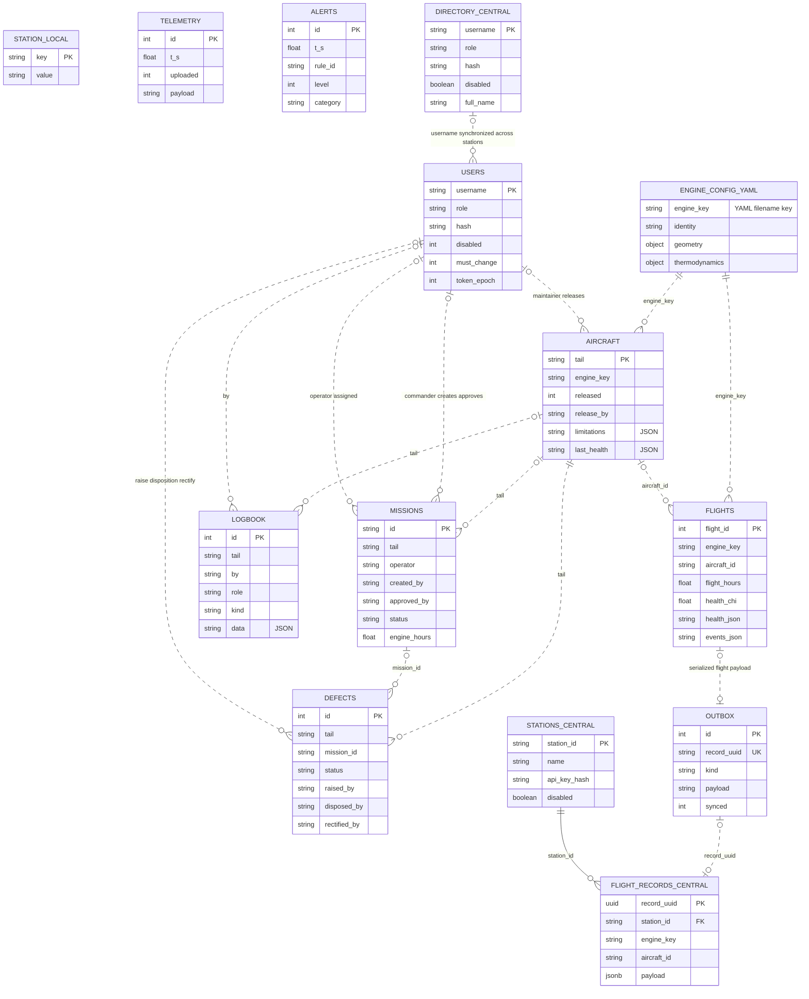
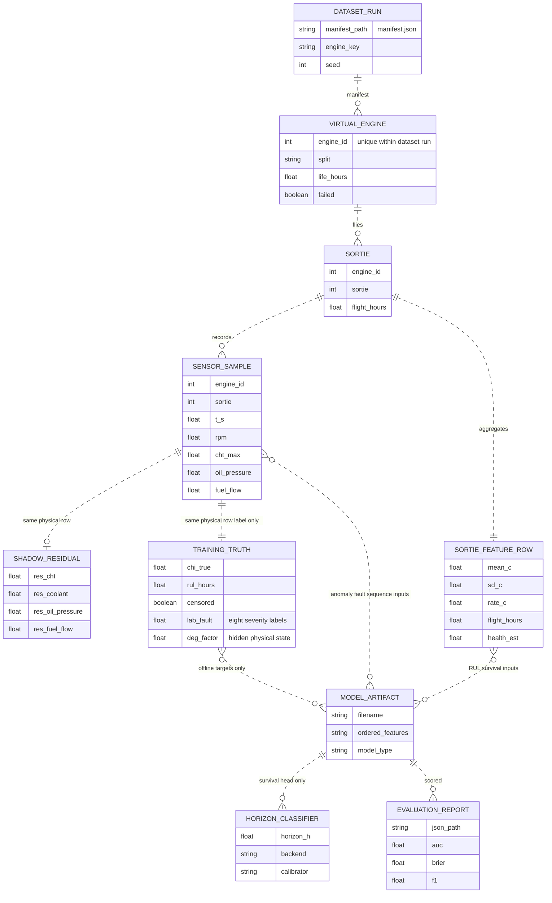

# Entity-Relationship Diagrams

This project has two separate ER diagrams, because they describe two different
things:

1. **The application database** — what the running ground-control-station
   software stores (users, aircraft, missions, defects, flight records).
2. **The ML training dataset** — the flat, simulation-generated data the
   fault-detection and remaining-life models are trained and evaluated on.

Both diagrams below are written in [Mermaid](https://mermaid.js.org/) syntax
(the ` ```mermaid ` fenced code blocks). They render automatically on GitHub,
in VS Code (with the Mermaid extension), and in most Markdown viewers — no
extra tool needed. Pasting either block into the
[Mermaid Live Editor](https://mermaid.live) also exports it directly as a PNG
or SVG image.

---

## 1. Project / application database ER diagram

Source: `docs/implementation_reference/database_er.mmd`

Commander, Operator, Maintainer and Engineer are *values* of a `role` column,
not four separate tables. Local users live in `data/keys/users.db`; the
central-fleet directory lives in PostgreSQL. Engine definitions are YAML
files (`configs/engines/*.yaml`), not a SQL table — `ENGINE_CONFIG_YAML` below
is explicitly marked as such.

**Storage boundaries** (which physical store each entity actually lives in):

| Store | Holds |
|---|---|
| `data/ops/squadron.db` | Aircraft, missions, defects, logbook, station |
| `data/keys/users.db` | Users |
| `data/history/flights.db` | Flights |
| `data/history/outbox.db` | Outbox |
| EdgeBuffer's SQLite path | Telemetry, alerts |
| Central PostgreSQL (`DT_FLEET_DSN`) | Stations, flight records, directory |
| `data/audit/audit.jsonl` | Audit records (a file, not a SQL table) |

**Reading the diagram:** a solid relationship line is a declared SQL foreign
key; a dashed line is a logical/application-level link, often crossing
between separate stores above — the database itself does not enforce dashed
links. Lines express the intended multiplicity, and an optional identifier
can be absent (e.g. a mission with no `approved_by` yet).



---

## 2. ML dataset ER diagram

Source: `docs/implementation_reference/ml_dataset_er.mmd`

This is a **conceptual** decomposition of flat Parquet records and model
artifact files — not a claim that these exist as SQL tables. Sample identity
is engine + sortie + time; `SHADOW_RESIDUAL` and `TRAINING_TRUTH` are extra
*columns* on the same physical `SENSOR_SAMPLE` row, not separately generated
rows, and are kept logically distinct from the features so that a model never
trains on its own label by accident (leakage).



---

## Where these came from

Both diagrams, and the fuller discussion behind them (why each design choice
was made, what each table's columns mean, the actual SQL and dataclass
definitions they were read from), live in
[`docs/implementation_reference/ASTRA_Engine_ML_Datasets_Database.md`](implementation_reference/ASTRA_Engine_ML_Datasets_Database.md)
— sections 8 and 9. This file is a focused extract of just the two diagrams
for quick reference and submission, not a replacement for that document.
